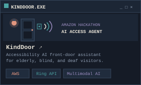
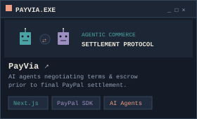
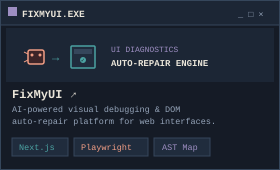
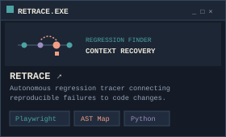
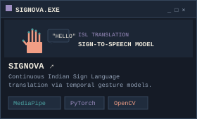
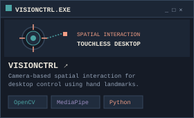

<!-- A. HERO WINDOW -->

 

<!-- B. DEVELOPER CONSOLE (ABOUT & TERMINAL) -->

 

<!-- C. ACTIVITY AND TELEMETRY -->

 

<table width="100%" cellspacing="0" cellpadding="0" border="0">
  <tr align="center">
    <td width="50%" align="center" style="border: none;">
      
    </td>
    <td width="50%" align="center" style="border: none;">
      
    </td>
  </tr>
</table>

 

<!-- GENUINE CONTRIBUTION SNAKE WORKFLOW OUTPUT -->

  
<code>[ ▰ TOGGLE AUTHENTIC CONTRIBUTION SNAKE ACTIVITY ]</code>

   
  
Reflects verified public commits generated daily via GitHub Actions.

  

 

<!-- D. FEATURED PROJECTS (3x2 INVENTORY GRID) -->

 

<table width="100%" cellspacing="0" cellpadding="4" border="0">
  <tr>
    <td width="33.33%" align="center" style="border: none;">
      
    </td>
    <td width="33.33%" align="center" style="border: none;">
      
    </td>
    <td width="33.33%" align="center" style="border: none;">
      
    </td>
  </tr>
  <tr>
    <td width="33.33%" align="center" style="border: none;">
      
    </td>
    <td width="33.33%" align="center" style="border: none;">
      
    </td>
    <td width="33.33%" align="center" style="border: none;">
      
    </td>
  </tr>
</table>

 

<!-- E. TECHNICAL INVENTORY -->

 

<!-- F. FOOTER & COMMUNICATIONS -->

  <a href="https://github.com/Guruprasad-Bhosale">GITHUB</a> &nbsp; / &nbsp;
  <a href="https://www.linkedin.com/in/guruprasad-bhosale/">LINKEDIN</a> &nbsp; / &nbsp;
  <a href="https://github.com/Guruprasad-Bhosale?tab=repositories">REPOSITORIES</a> &nbsp; / &nbsp;
  <a href="mailto:guruprasadbhosale404@gmail.com">EMAIL</a>

  

 

GP-OS v2.4 // Built with deliberate pixel clusters, crisp typography &amp; authentic telemetry

