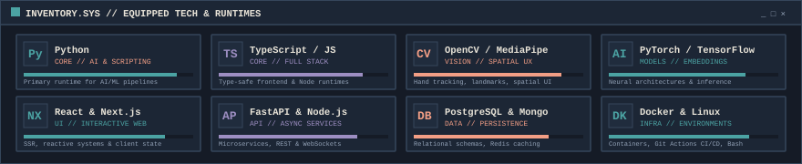
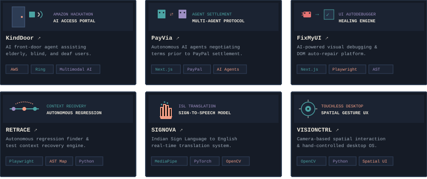
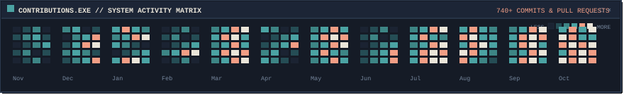
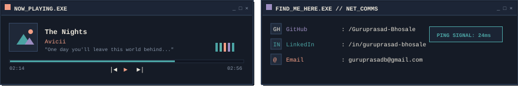

<div align="center">

<!-- RETRO INDIE-GAME OS // HERO BANNER -->
<a href="https://github.com/Guruprasad-Bhosale">
  
</a>

<br/>

<!-- SYSTEM STATUS & DEVELOPER CONSOLE -->


<br/>

<!-- RPG TECH INVENTORY -->


<br/>

<!-- ACTIVE MISSIONS & FEATURED ARTIFACTS -->




</div>

### `//` 📂 `MISSION_LOG.MD` — DIRECT REPOSITORY ACCESS

| Artifact / Quest | Role & Capability | Equipped Tech | Access Link |
| :--- | :--- | :--- | :---: |
| **[KindDoor](https://github.com/Guruprasad-Bhosale/KindDoor)** | Real-time multimodal AI front-door assistant tailored for elderly, blind, and deaf individuals. Built for Amazon Hackathon. | `AWS` `Ring API` `Multimodal AI` | [Inspect ↗](https://github.com/Guruprasad-Bhosale/KindDoor) |
| **[PayVia](https://github.com/Guruprasad-Bhosale/PayVia)** | Autonomous multi-agent negotiation protocol facilitating settlement agreement before PayPal transaction execution. | `Next.js` `PayPal SDK` `AI Agents` | [Inspect ↗](https://github.com/Guruprasad-Bhosale/PayVia) |
| **[FixMyUI](https://github.com/Guruprasad-Bhosale/FixMyCode)** | AI-driven visual regression debugging platform detecting DOM breakages and recommending deterministic CSS/layout fixes. | `Next.js` `Playwright` `AST` | [Inspect ↗](https://github.com/Guruprasad-Bhosale/FixMyCode) |
| **[RETRACE](https://github.com/Guruprasad-Bhosale/RETRACE)** | Autonomous regression tracer identifying breaking code commits and recovering previous execution context maps. | `Playwright` `AST Map` `Python` | [Inspect ↗](https://github.com/Guruprasad-Bhosale/RETRACE) |
| **[SIGNOVA](https://github.com/Guruprasad-Bhosale/SIGNOVA)** | Real-time Indian Sign Language (ISL) to speech and text translation system leveraging spatial hand tracking. | `MediaPipe` `PyTorch` `OpenCV` | [Inspect ↗](https://github.com/Guruprasad-Bhosale/SIGNOVA) |
| **[VISIONCTRL](https://github.com/Guruprasad-Bhosale/VISIONCTRL)** | Camera-based touchless human-computer interface enabling spatial navigation and hand-controlled desktop workflows. | `OpenCV` `Python` `MediaPipe` | [Inspect ↗](https://github.com/Guruprasad-Bhosale/VISIONCTRL) |

<br/>

<div align="center">

<!-- LIVE TELEMETRY & GITHUB ACTIVITY -->


<br/>

<!-- Real Live GitHub Stats & Streaks with Exact Slate Blue / Dusty Teal / Peach / Lavender Palette -->
<table border="0" cellpadding="0" cellspacing="0" width="100%">
  <tr align="center">
    <td width="50%" align="center" style="border: none;">
      <a href="https://github.com/Guruprasad-Bhosale">
        
      </a>
    </td>
    <td width="50%" align="center" style="border: none;">
      <a href="https://github.com/Guruprasad-Bhosale">
        
      </a>
    </td>
  </tr>
</table>

<br/>

<!-- ACTIVITY MATRIX / HEATMAP -->


<br/>

<!-- OPTIONAL: ANIMATED CONTRIBUTION SNAKE -->
<details>
  <summary align="center"><code>[ ▰ TOGGLE CONTRIBUTION SNAKE ANIMATION ]</code></summary>
  <br/>
  
</details>

<br/>

<!-- AMBIENT AUDIO & NETWORKING COMMS -->


<br/>

<!-- SYSTEM TASKBAR & REPO FOOTER -->
<a href="https://github.com/Guruprasad-Bhosale/Guruprasad-Bhosale">
  
</a>

<br/>

```
[ QUICK-SAVE: PRESS ★ ON THIS REPO TO SYNC CHECKPOINT ]
```

<sub>Crafted with custom pixel typography, SVG vector rendering, and clean retro OS architecture.</sub>

</div>
